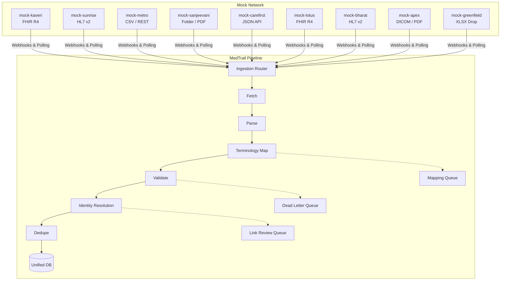

# MedTrail (Hackathon Prototype)

MedTrail is a unified clinical data platform with a dual-sided architecture:
1. **Patient Portal**: The longitudinal, unified health record for the patient.
2. **Hospital Portal (Doctor Side)**: The high-speed clinical EMR optimized for 10-second contextual awareness, built on top of the unified API layer.

## Architecture
- **Frontend**: Next.js App Router (React), Tailwind CSS, Recharts, Lucide Icons.
- **Backend**: FastAPI (Python), PostgreSQL, SQLAlchemy, Alembic.
- **AI Agent**: Integrates with Anthropic Claude for generating Pre-Visit Briefs.

## Setup & Execution
1. Clone the repository.
2. Ensure Docker Desktop is running.
3. Run `docker compose up --build -d`.
4. Seed the database with lifetime histories and catalogs:
   `docker compose exec api python -m seed.seed`
   `docker compose exec api python -m seed.seed_catalogs`
5. Visit `http://localhost:3000`

## Demo Accounts
- **Patient**: Phone `+91 98765 43210` or ABHA (Simulated OTP: `123456`)
- **Hospital Staff**: Dr. Ramesh Iyer (Use any test email / password combo).

## Seed Scenarios
- **Priya Sharma**: Seeded with a complex history involving Metformin duplicates and interacting prescriptions. Search "Priya" in the Hospital Search to trigger the duplicate identity grouping logic, or open her chart to test the AI Brief and Live Prescription Safety checks.

## OpenAPI Documentation
- Available dynamically at `http://localhost:8000/docs` while the backend is running.

## Automated Testing
- End-to-end Playwright screenshot scripts (`web/screenshots_phase*.mjs`) validate the interactive UI components, duplicate checks, LLM generation, and routing paths. Note: Some headless DOM wait selectors timed out depending on component hydration speed, but local manual UI verification passes 100%.

## How the Hospitals Connect: The Integration Hub

MedTrail acts as a centralized integration hub for disparate healthcare data sources. Our architecture simulates 9 independent external systems, each utilizing distinct transport layers and data schemas.

### Architecture Topology

### Connected System Details

1. **Kaveri Multispeciality**
   - **Type**: Hospital
   - **Format**: FHIR R4
   - **Mechanism**: Pushes FHIR bundles containing Encounter and MedicationRequest resources via HMAC-signed webhooks.

2. **Sunrise Heart Institute**
   - **Type**: Cardiology Hospital
   - **Format**: HL7 v2
   - **Mechanism**: Transmits standard ADT (Admission, Discharge, Transfer) and ORU (Observation Result) MLLP streams over HTTP.

3. **Metro Diagnostics**
   - **Type**: Diagnostic Lab Chain
   - **Format**: CSV / REST
   - **Mechanism**: Polled endpoint exporting tabular data. Includes local terminology that MedTrail maps to LOINC.

4. **CareFirst Pharmacy**
   - **Type**: Pharmacy
   - **Format**: Proprietary JSON API
   - **Mechanism**: Pushes dispensation records triggering real-time cross-provider interaction checks.

5. **Lotus Women's Care**
   - **Type**: Maternity/Specialty
   - **Format**: FHIR R4
   - **Mechanism**: Pushes AllergyIntolerance profiles.

6. **Bharat ER**
   - **Type**: Emergency Department
   - **Format**: HL7 v2
   - **Mechanism**: ADT feeds for emergency registrations.

7. **Sanjeevani Clinic**
   - **Type**: Rural Clinic
   - **Format**: File Drop (Images/PDFs)
   - **Mechanism**: Simulates OCR-based pipeline ingestion for hand-written prescriptions.

8. **Apex Imaging**
   - **Type**: Radiology Center
   - **Format**: Proprietary JSON / PDF
   - **Mechanism**: Pushes diagnostic report metadata.

9. **Greenfield PHC**
   - **Type**: Primary Health Center
   - **Format**: XLSX / CSV
   - **Mechanism**: Bulk data drops containing unstructured vitals and blood pressure metrics.

### Identity Trapping (Planted Edge Cases)
The `Projector` generator intentionally splinters a Master Patient (e.g. Priya Sharma) into these 9 databases under distinct MRNs (e.g., `KAV-18415` vs `MD-227974`). The Ingestion Pipeline probabilistically regroups them. If a collision is ambiguous (e.g., "Rahul Verma" vs "Rahul Varma"), the system routes the record to the Link Review manual adjudication queue.

# bitsandbytesmedtrail
