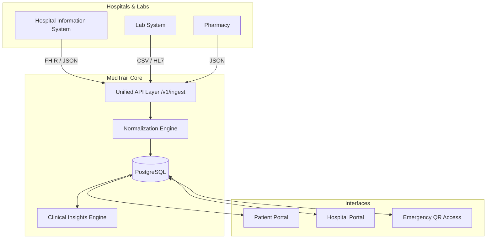

# MedTrail: ABDM-Aligned Unified Health Record

MedTrail solves fragmented medical history by giving patients a single, secure timeline and giving hospitals a point-of-care clinical dashboard via a unified API.

## Architecture



## Setup & Running

1. **Clone and run:**
   ```bash
   docker compose up --build
   ```
2. **Database Migrations and Seed:**
   The `api` container automatically runs `alembic upgrade head` and the deterministic synthetic seed script (`python -m seed.seed`) upon boot.
3. **Ports:**
   - Web App: http://localhost:3000
   - API Docs (OpenAPI): http://localhost:8000/docs
   - MinIO Console: http://localhost:9001

## Demo Accounts

### Patient Portal
Navigate to `/login` and select "Patient".
- **Phone:** `+919876543210` or **ABHA ID:** `91-4821-6590-3322`
- **OTP:** `123456`
*(This logs into Priya Sharma, our hero patient with T2DM, hypertension, and multiple conflicts).*

### Hospital Portal
Navigate to `/login` and select "Hospital Staff".
- **Hospital ID:** `HOSP-KAV-001`
- **Email:** `ramesh.iyer@kaveri.local`
- **Password:** `password123`
- **OTP:** `123456`

## Seed Scenarios

The seed script deterministically generates 40 patients (5 "Hero" patients with rich histories and conflicts, 35 moderate histories).
- **Priya Sharma (47)**: T2DM + Hypertension + Hypothyroid. Fragmented records across 8 providers. Contains an active duplicate Metformin prescription (500mg vs 1000mg) and a repeated HbA1c test within 21 days.
- **Ramesh Iyer (58)**: CAD post-angioplasty. Aspirin interaction.
- **Fatima Khan (34)**: Asthma. Documented allergy with a conflicting antibiotic prescription.
- **Arjun Reddy (29)**: Unconscious ER scenario (test ER quick lookup).
- **Kavita Nair (62)**: CKD Stage 3. Rising creatinine trend across 3 different labs.
