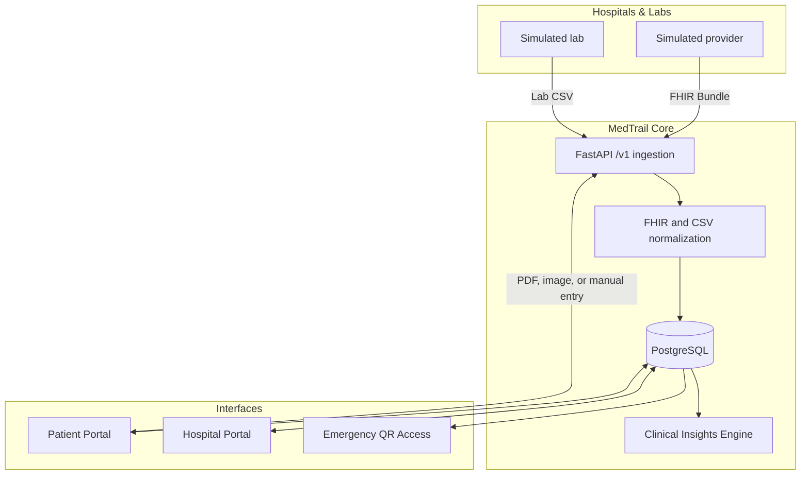

# MedTrail: Unified Health Record Demo

MedTrail is a hackathon prototype for fragmented medical history. It provides a patient record timeline, consent-scoped clinician access, temporary patient-controlled share links, emergency lookup, and a simulated provider ingestion API. It uses synthetic demo data and is not connected to ABDM or real hospital systems.

## Architecture



Patient uploads are extracted for review before records are added. Provider ingestion and clinician views require active patient consent; public share links are scoped and expire, and patients can revoke them. The emergency card is a separate temporary access path.

## Technology

- Patient and clinician portals: Next.js, React, TypeScript, Tailwind CSS
- API: Python, FastAPI, SQLAlchemy
- Storage: PostgreSQL and MinIO for uploaded files
- Local orchestration: Docker Compose
- Ingestion: supported FHIR resources and lab CSV; provider document ingestion and real integrations are not implemented

## Setup & Running

1. **Clone and run:**
   ```bash
   docker compose up --build
   ```
2. **Database migrations and seed:**
   The `api` container automatically runs `alembic upgrade head` and the deterministic synthetic seed script (`python -m seed.seed`) upon boot.
3. **Ports:**
   - Web App: http://localhost:3000
   - API Docs (OpenAPI): http://localhost:8000/docs
   - MinIO Console: http://localhost:9001

## Demo Accounts

### Patient Portal
Navigate to `/login` and select "Patient".
- **Phone:** `+919876543210` or **ABHA ID:** `91-4821-6590-3322`
- **OTP:** `123456`
*(This logs into Priya Sharma, our hero patient with T2DM, hypertension, and multiple conflicts).*

### Hospital Portal
Navigate to `/login` and select "Hospital Staff".
- **Hospital ID:** `HOSP-KAV-001`
- **Email:** `ramesh.iyer@kaveri.local`
- **Password:** `password123`
- **OTP:** `123456`

## Seed Scenarios

The seed script deterministically generates 40 patients (5 "Hero" patients with rich histories and conflicts, 35 moderate histories).
- **Priya Sharma (47)**: T2DM + Hypertension + Hypothyroid. Fragmented records across 8 providers. Contains an active duplicate Metformin prescription (500mg vs 1000mg) and a repeated HbA1c test within 21 days.
- **Ramesh Iyer (58)**: CAD post-angioplasty. Aspirin interaction.
- **Fatima Khan (34)**: Asthma. Documented allergy with a conflicting antibiotic prescription.
- **Arjun Reddy (29)**: Unconscious ER scenario (test ER quick lookup).
- **Kavita Nair (62)**: CKD Stage 3. Rising creatinine trend across 3 different labs.

## Prototype limitations

Patient OTP and hospital OTP delivery, production identity verification, real provider connectivity, and provider document ingestion are not configured. Demo accounts and seeded records are for demonstration only. Do not use this prototype for real patient data or clinical decisions.
